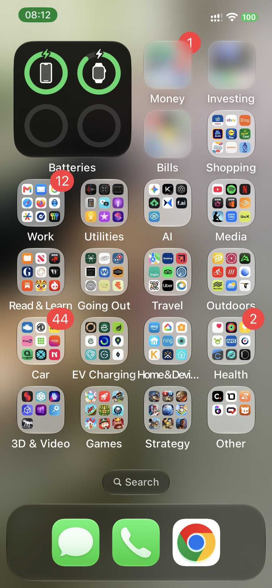

# Organise an iPhone or iPad Home Screen with Claude Code

Tidy a messy Home Screen from any computer, over a USB cable, using
[Claude Code](https://claude.com/claude-code). No Mac needed, no jailbreak, no app to buy.
Nothing is installed on the device and no app is deleted. Only the positions of icons change.

Thirteen pages of apps became two on an iPhone 12, and fourteen became two on an iPad mini.
The write-up is at
[graith.co.uk](https://www.graith.co.uk/articles/organising-an-iphone-home-screen-with-claude-code.php).

## The guides

| Device | File | Tested on |
|--------|------|-----------|
| iPhone | [ORGANISE-IPHONE.md](ORGANISE-IPHONE.md) | iPhone 12, iOS 27.0.1 |
| iPad | [ORGANISE-IPAD.md](ORGANISE-IPAD.md) | iPad mini (5th generation), iPadOS 26.7.3 |

Each guide is one file. It holds the instructions Claude Code follows and the Python script it uses.

## Use it

1. Take a full backup of the device.
2. Plug the device into the computer with a USB cable and unlock it.
3. Save the guide for your device in an empty folder.
4. Start Claude Code in that folder and say:

   > Read ORGANISE-IPHONE.md and follow it.

5. Choose a style when asked, read the plan, and say yes.

## How it keeps your icons safe

- **Backup first.** Every read and every write saves the current layout to a dated file in `backups/`.
- **Incomplete plans are refused.** An app that is missing, listed twice or unknown stops the run before anything is written.
- **Read back after writing.** The script compares what the device now has with the plan.
- **One command to undo.** `restore` writes any backup back to the device.
- **Wrong-device guard (iPad script).** A backup from one device is not written to another.

## Before you start

- This uses an unofficial interface, the one iTunes once used to arrange icons. Apple could change it in any update.
- The names of your apps are sent to the AI model so that it can sort them.
- The script depends on [pymobiledevice3](https://github.com/doronz88/pymobiledevice3), which installs about 90 packages. Version 11.63.1 was checked on 25 November 2026 (file hashes against PyPI, OSV advisories, code scan). Check any newer version yourself before you install it.
- The first write usually brings back apps from Home Screen pages you had hidden. Claude Code reads the layout again, files them and writes once more. The guides explain this.
- `restore` has not been run on a real device yet.
- Use at your own risk.

## Licence

MIT. See [LICENSE](LICENSE).
